# Pokémon Ruby, Sapphire & Emerald NDS

Pokémon Ruby, Sapphire and Emerald, remade on the Nintendo DS inside Pokémon Black 2. The whole Hoenn region is rebuilt in Black 2's 3D overworld, and the complete story plays out with Black 2's music and battle system. Hoenn's characters are their original sprites, resized and animated for the DS.

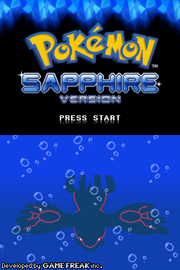
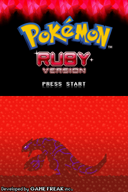

**This repository contains patches only.** No ROMs are provided. You need your own dump of Pokémon Black Version 2.

**Join the Discord** to report bugs, make suggestions and follow updates: https://discord.gg/5qxKVHKxW

## Three versions

**Pokémon Sapphire NDS:** Team Aqua plans to expand the seas by awakening the legendary Kyogre, and you chase them from Slateport's harbour to the depths of Seafloor Cavern.

**Pokémon Ruby NDS:** Team Magma plans to expand the land by awakening the legendary Groudon. You face Maxie, Tabitha and Courtney, explore Magma Hideout, and meet Groudon under a scorching sky.

**Pokémon Emerald NDS (new, v1.0):** Team Magma and Team Aqua both chase their legendary Pokémon, and only Rayquaza can stop Groudon and Kyogre's clash over Sootopolis. Emerald's own maps, trainers, Gym puzzles and wild Pokémon, Steven's tag battle at the Space Center, Juan as Sootopolis' Gym Leader, and the Battle Frontier with all seven facilities.

## Modern quality-of-life features

- Field moves work without teaching HMs: just the badge and the HM in your Bag.
- A Gen 6-style Exp. Share you switch on and off. Opponent levels are scaled to match it.
- Every trade evolution happens in-game, by level-up or by using an item.
- Emerald's event islands (Southern Island, Faraway Island, Birth Island and Navel Rock) unlock in-game, no Mystery Gift needed.
- A bigger post-game: the National Dex, seven roaming legendaries, Jirachi, Celebi, Mirage Island and Altering Cave.
- Your choice at the start of the adventure: the Fairy type (with Gen 6's type chart and new Fairy moves), modern or classic physical/special split, and Hoenn's original soundtrack (played on Black 2's instruments) or Black 2's music.
- The Hoenn Battle Tower, and the Pokémon World Tournament on the Battle Tower island.
- The Hoenn town map and Pokédex.
- Emerald only: the Battle Frontier (Tower, Dome, Palace, Arena, Factory, Pike and Pyramid, with Battle Points and their prizes), the move tutors, and Emerald's post-game (Steven in Meteor Falls, Groudon and Kyogre in Terra and Marine Cave, the Johto starters).

## Screenshots

| Sapphire | Ruby |
|---|---|
| 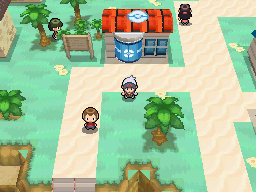 | 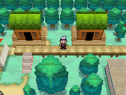 |
| 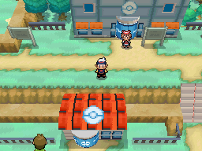 | 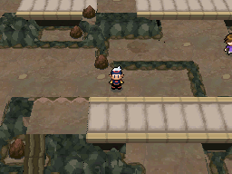 |
| 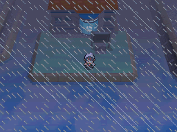 | 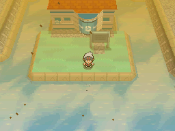 |
| 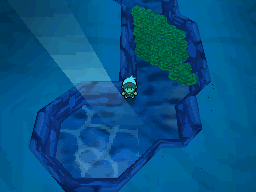 | 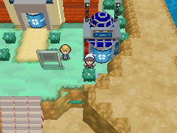 |
| 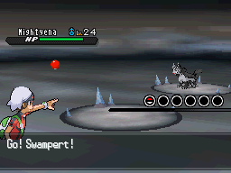 | 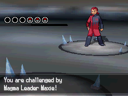 |
| 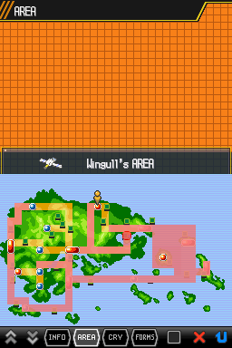 | 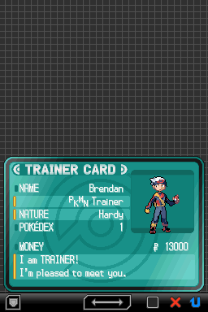 |

More shots, with captions, are in [screenshots/](screenshots/).

## How to play

1. Get your own dump of **Pokémon Black Version 2** (USA/Europe, game code `IREO`). It must match exactly:
   - size 536,870,912 bytes
   - CRC32 `D4427FD1`
   - SHA-1 `e51e6dfb8678a3d19dcd2a10691b96a569ca0abb`
2. Download `Pokemon_Sapphire_NDS_v18.0.bps`, `Pokemon_Ruby_NDS_v18.0.bps` or `Pokemon_Emerald_NDS_v1.1.bps` from [Releases](../../releases).
3. Apply it to your dump with a BPS patcher, such as [Rom Patcher JS](https://www.marcrobledo.com/RomPatcher.js/) (in the browser), Floating IPS or beat.
   **Patch on a computer, not a phone.** Black 2 is a 512 MB game, and patching it takes more memory than a phone browser allows, so the patcher crashes or reloads. Patch on a Windows PC or Mac (Rom Patcher JS works in Chrome or Firefox), then copy the patched `.nds` to your phone.
4. Play the patched `.nds` in an emulator such as melonDS, DraStic, DeSmuME or Delta (iPhone).

Use in-game saves. When you update to a new version, your save carries over, but emulator save states don't.

## Player guide

The [player guide](docs/README.md) lists each version's wild Pokémon, item locations and important trainers, plus the TMs and HMs, the Fairy type changes, the trade evolutions, the start-of-game options and Emerald's Battle Frontier rules.

## Trading and battling with friends

Every Pokémon Center has the Cable Club upstairs. Once you have your Pokédex:
- **Left desk, Union Room (local wireless):** trade and battle with players near you, or with a second emulator window (melonDS: System → Multiplayer → Launch new instance).
- **Middle desk, Wi-Fi Club (online):** trade and battle with friends registered in your Pal Pad (Key Items). Online play needs a Wiimmfi-patched ROM, as for Black 2. It hasn't been tested with two real players yet.

Sapphire, Ruby and Emerald NDS all meet each other, so you can complete the Hoenn Pokédex by trading.
- Everyone needs **Sapphire/Ruby NDS v18.0 or Emerald NDS v1.1, or later**. Older versions and the original Black 2/White 2 don't show up, because they can't safely read the Fairy moves and new items.
- **Trade evolutions work both ways:** trade them (Kadabra, Machoke, Onix holding a Metal Coat…) or use the in-game ways (levels, items from the Bag).
- **Link battles use the host's rules:** the Fairy type and the physical/special split follow the answers of the player whose game hosts the battle. Pick the same answers at the start of the game if you always want your own rules.

## Bug reports and suggestions

Please report bugs and share suggestions on the [Discord](https://discord.gg/5qxKVHKxW), or open an issue here. A screenshot, your version (Sapphire, Ruby or Emerald, and the version number) and where it happened help a lot.

## Source code

The code that builds these games is open source (MIT License) at **[logdog2325/HoennB2](https://github.com/logdog2325/HoennB2)**, for anyone who wants to learn from it or reuse it in their own projects. It contains no ROMs; you build from your own dumps.

## Credits

- **Game Freak, Nintendo, Creatures and The Pokémon Company:** Pokémon Ruby, Sapphire, Emerald and Black 2.
- **[pret](https://github.com/pret):** the pokeruby and pokeemerald decompilations (Emerald's maps, story, trainers and Battle Frontier come from pokeemerald).
- **[pokebw2](https://github.com/fuddlesworth/pokebw2):** the Pokémon Black 2 / White 2 decompilation.
- **Emerald's own art and music:** Emerald's title screen, character outfits, Steven's battle back sprite and Emerald's new songs (including the 13 Battle Frontier songs) come from the original Pokémon Emerald, converted for the DS.

Sprites (the NEW sprite set, chosen at the start of the game):
- **hyo-oppa:** Brendan (overworld, battle front and back), Emerald's Brendan (battle front and back) and Wally (battle front).
- **Kymotonian and Klein Studio:** Wally (overworld).
- **Wolfang62:** Professor Birch (overworld).
- **DiegoWT:** May and Archie (originally commissioned by Zailens and Kyledove).
- **joojishibuki:** Maxie's battle sprite.
- **Kimmylube** and **AzureAquarian:** Team Aqua and Team Magma grunts.

Tools used:
- **ds-decomp (dsd)** by AetiasHax: DS disassembly.
- **CTRMap / CTRMapV** by HelloOO7: DS 3D model writing.
- **apicula** by scurest: DS model tools.
- **DeSmuME**, **py-desmume** and **melonDS**: testing.
- **Python, NumPy and Pillow**: build tools.

AI (Claude by Anthropic) was used to help code this project.

This is a non-commercial fan project. It is not affiliated with or endorsed by Nintendo, Game Freak, Creatures or The Pokémon Company. Please support the official games.
