# Pokémon Ruby & Sapphire NDS

Pokémon Ruby and Sapphire, remade on the Nintendo DS inside Pokémon Black 2. The whole Hoenn region is rebuilt in Black 2's 3D overworld, and the complete story plays out with Black 2's music and battle system. Hoenn's characters are their original sprites, resized and animated for the DS.

**This repository contains patches only.** No ROMs are provided. You need your own dump of Pokémon Black Version 2.

## Two versions

**Pokémon Sapphire NDS:** Team Aqua plans to expand the seas by awakening the legendary Kyogre, and you chase them from Slateport's harbour to the depths of Seafloor Cavern.

**Pokémon Ruby NDS:** Team Magma plans to expand the land by awakening the legendary Groudon. You face Maxie, Tabitha and Courtney, explore Magma Hideout, and meet Groudon under a scorching sky.

## Modern quality-of-life features

- Field moves work without teaching HMs: just the badge and the HM in your Bag.
- A Gen 6-style Exp. Share you switch on and off. Opponent levels are scaled to match it.
- Every trade evolution happens in-game, by level-up or by using an item.
- Emerald's event islands (Southern Island, Faraway Island, Birth Island and Navel Rock) unlock in-game, no Mystery Gift needed.
- A bigger post-game: the National Dex, seven roaming legendaries, Jirachi, Celebi, Mirage Island and Altering Cave.

## Screenshots

| Sapphire | Ruby |
|---|---|
| 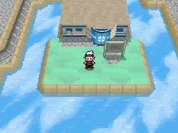 | 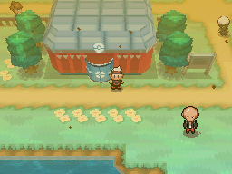 |
| 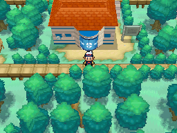 | 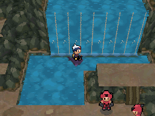 |
| 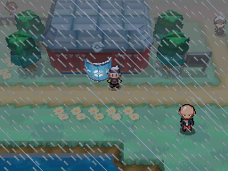 | 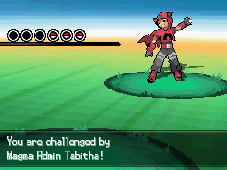 |
| 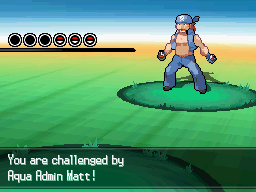 | 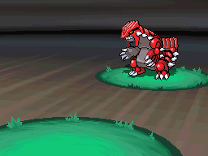 |
| 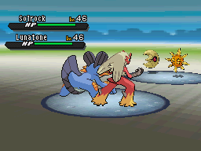 | 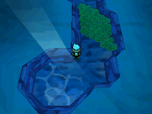 |
| 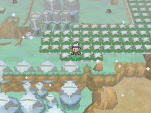 | 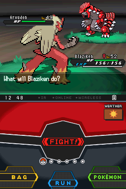 |

More shots, with captions, are in [screenshots/](screenshots/).

## How to play

1. Get your own dump of **Pokémon Black Version 2** (USA/Europe, game code `IREO`). It must match exactly:
   - size 536,870,912 bytes
   - CRC32 `D4427FD1`
   - SHA-1 `e51e6dfb8678a3d19dcd2a10691b96a569ca0abb`
2. Download `Pokemon_Sapphire_NDS_v15.3.bps` or `Pokemon_Ruby_NDS_v15.3.bps` from [Releases](../../releases).
3. Apply it to your dump with a BPS patcher, such as [Rom Patcher JS](https://www.marcrobledo.com/RomPatcher.js/) (in the browser), Floating IPS or beat.
4. Play the patched `.nds` in an emulator such as melonDS, DraStic or DeSmuME.

Use in-game saves. When you update to a new version, your save carries over, but emulator save states don't.

## Coming soon

- **Next update:** the Hoenn Battle Tower and the Pokémon World Tournament, plus an optional Fairy type you choose at the start of your adventure.
- **Pokémon Emerald NDS**

## How it was made

This project was made with a lot of help from AI. Anthropic's Claude wrote most of the code and tooling: the map converters, script ports, patches and test tools. The creator directed the project, made the design decisions, reviewed the results and play-tested. Everything was built from the original games' own data, the open decompilation projects below and Black 2's own assets. No outside ROMs or game files were downloaded.

## Credits

- **Game Freak, Nintendo, Creatures and The Pokémon Company:** Pokémon Ruby, Sapphire, Emerald and Black 2.
- **[pret](https://github.com/pret):** the pokeruby and pokeemerald decompilations.
- **[pokebw2](https://github.com/fuddlesworth/pokebw2):** the Pokémon Black 2 / White 2 decompilation.
- **CTRMap / CTRMapV** by HelloOO7, and **apicula** by scurest: Nintendo DS model tools.
- **ds-decomp (dsd)**, **DeSmuME** and **melonDS**: disassembly and testing.

This is a non-commercial fan project. It is not affiliated with or endorsed by Nintendo, Game Freak, Creatures or The Pokémon Company. Please support the official games.
